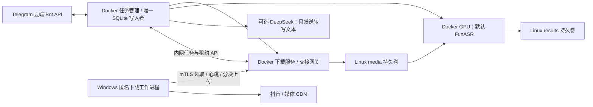

# Windows 抖音下载适配器设计（待审阅，未实施）

2026-10-12。当前问题是同一新工具在 Windows 三个公开视频匿名下载并解码成功，在 WSL/Docker 的目标 GET 返回真实零正文。上游路径尚未隔离，不能判定原因；Windows 3/3 仅支持技术可行性，尚未通过稳定性或生产验收。

本文件只提出设计。没有修改 Compose、应用代码、网络、证书或原项目；没有启动 Windows 常驻服务，也没有重新下载样本。只读核查结果见 [UPSTREAM-READONLY-NOTE.md](diagnostics/douyin/UPSTREAM-READONLY-NOTE.md)。附件旧报告作为证据材料，其中启动/测试示例没有执行。

## 1. 建议边界与数据流

建议采用 **Windows 主动领取任务、上传媒体**。Windows 不提供监听端口，不依赖 Docker 主动访问 Windows 的临时 WSL 地址；Docker 只新增一个宿主回环接口用于适配器。公开媒体下载流量由 Windows 浏览器发起。

Telegram 白名单、任务归属、按钮去重、SQLite、GPU 引擎选择/并发/显存释放、原稿先发送、DeepSeek 分块和发送重试均继续由现有 Docker 组件负责。YouTube/X 仍使用 Docker 下载路径。只有抖音解析/下载委派到 Windows，不自动运行另一套引擎或回退 CPU/云端。

网关建议并入现有 `download` 容器，负责协议、分块文件及 Docker 媒体验收；**不写 SQLite**。租约/状态 API 位于 manager 的独立内网监听，由 manager 的任务事件循环统一写 SQLite。不能让 HTTP 回调线程另开数据库写入者。当前 `v2t/manager.py::Manager.process()`、`v2t/service.py::Handler.do_POST()`、`v2t/download.py::cached_media()/probe()/decode_audio()` 是未来对接点，现阶段未修改。

正常任务保持下载服务 `/run` 的外部契约：manager 标记下载阶段，下载服务先检查已有有效媒体；只有缺失且为抖音时请求 manager 创建 Windows 下载记录，并有界等待交接结果。下载服务健康检查不依赖 manager，避免当前 Compose 启动依赖形成死锁。Windows 离线时快速报告，不阻塞其它平台到无限期。

## 2. Windows 运行隔离与原项目保护

建议安装根目录为新的 `%LOCALAPPDATA%\TelegramVideo2TextAdapter\<installation_id>`，与 `C:\Users\justd\Desktop\Video2Text1` 完全分离。仅在后续批准实施时创建：

| 子目录 | 内容 |
|---|---|
| runtime / app | 独立运行时、锁定依赖、适配器源码 |
| browsers | 固定 Playwright 对应 Chromium，不沿用浏览器登录资料 |
| spool / task_id / attempt_id | 临时媒体、校验结果与上传进度 |
| logs | 固定错误码、作品 ID、阶段、耗时和数量 |
| credentials | 适配器专用客户端证书/私钥、服务器信任文件，仅当前 Windows 账户可读 |

优先以已验证 **B 新工具**为解析/下载基础：Playwright 1.58.0、Chromium 145.0.7632.6、现有 Windows UA、无头模式、资源拦截、匿名上下文、目标 ID 匹配。首版不改用自动更新的系统 Chrome，也不增加特征伪造。现有 Windows 验证使用 Python3.10.0 和 FFmpeg7.0；独立打包的 Python/FFmpeg 版本需记录并单独验证，不能假定替换后仍继承3/3结果。

每个任务创建新的浏览器上下文和临时 profile，仅使用本次匿名会话产生的 Cookie，任务结束后不保存可复用登录状态。不读取原程序 `.env`、`.douyin_state.json`、原缓存或浏览器用户目录；不运行原 dy.py CLI、转写/整理脚本及清理逻辑。不向浏览器子进程传递 Telegram/DeepSeek 密钥、适配器客户端私钥或 Docker socket；凭据仅由工作进程的控制通信部分使用，不声称已完成操作系统级隔离验收。

Windows 仅解析、下载和做无识别的媒体验证，不提取供 ASR 使用的长期音频。可用 FFprobe 和音轨全解码至空设备验证下载完整性；GPU 所用16kHz mono PCM仍由 Docker重新生成。不得把取得候选 URL 或 HTTP200当作成功。

B 目前通过的是 Playwright APIRequestContext 下载。不能默默换成另一个 HTTP 客户端后宣称同路线已验。SDK可能整文件缓冲：设计必须先检查声明长度，并对自有 Python/Node/Chromium进程组设置内存预算和任务超时；建议候选整体内存预算2GiB，实际值待实施验证。500MiB媒体上限不能代替内存上限。将来改为流式下载必须单独验证匿名 Cookie 的域/路径/secure规则与网络路径。

## 3. 通信、认证与网络暴露

Windows 工作进程只向 Docker Desktop 发布的 `https://127.0.0.1:<adapter_port>` 主动连接、领取和上传。候选端口18765尚未核查占用或实测连通，**当前没有监听**。

后续拟仅发布 `127.0.0.1:18765 → download 的独立 TLS 网关端口`；不发布现有无外部认证的 `/run`、GPU、SQLite或manager内网API，不绑定0.0.0.0/::，不开放LAN/公网，不开启SMB共享、不修改路由器端口转发。Windows工作进程没有入站接口。

Docker 官方支持将发布端口限制到宿主回环，并由 Desktop 转发宿主连接到容器；这是设计依据，**本机适配器连通性/暴露范围尚待验收**，不能直接宣称已经安全可用：[Desktop networking](https://docs.docker.com/desktop/features/networking/)、[Port publishing](https://docs.docker.com/engine/network/port-publishing/)。若回环连接验证失败，先报告具体问题，不自行拓宽监听或修改防火墙/全局网络。

认证建议采用专用 **双向 TLS（mTLS）**：

- Windows验证专用服务器信任链、回环地址证书标识及预期服务器证书/公钥；不关闭TLS验证，不添加全局系统信任根。
- 网关要求客户端证书并将允许的证书标识绑定 worker_id；未经授权不能领取任务、查看状态或上传。
- manager另外分配随机租约标识，绑定task_id、attempt_id、worker_id、generation、输入摘要和截止时间，并持久化租约元数据。租约标识不是独立Bearer凭据：每次操作都必须通过mTLS证书身份及数据库归属/有效期检查。这样claim响应丢失或manager重启后可幂等返回同一租约，不需要恢复已丢失的秘密值。
- Docker 网关→manager 控制 API使用独立服务身份认证，仅 backend 网络可达，Windows客户端身份不能直接调用该API。
- 私钥及其他身份凭据不写Compose正文、命令行、诊断输出或Git；只给相应进程读取权限。本阶段不生成任何密钥/证书。

TLS客户端证书校验参考 Python官方 [ssl](https://docs.python.org/3/library/ssl.html)。这里选择标准mTLS，不自行发明加密协议。TLS认证不替代任务归属、输入限制与幂等检查。

只接受 manager 已创建的抖音下载任务。工作进程不能提交任意 URL 或磁盘目标路径；用户分享文本先由 manager提取/规范化链接，普通长链只保留公共作品ID，短链只保留公开短链码。短链未知ID时以最终页面解析ID与详情ID相符验收；已知ID必须精确匹配。跳转/候选地址做平台、媒体域及非私网限制；遇到fake-IP依据已审阅的域名策略单独处理，不把放行当作出口正确性的证明。

## 4. 文件交接与接口草案

不让 Docker 读取 Windows spool，不使用原项目或 `/mnt/c`作为共享媒体库。Windows先写本格 `media.part`，验证后提交本地完整媒体；经HTTPS上传原始媒体字节到Linux media卷。Windows侧只保留有界的本地续传材料，Linux media/models/results/database继续分卷持久化。

每个请求含独立 request_id；重试同一业务操作保留 request_id，并校验请求内容摘要，冲突返回明确错误。除领取以外，接口必须匹配证书身份、有效租约及generation。

| 接口草案 | 作用/幂等边界 |
|---|---|
| POST /adapter/v1/claim | 有界长轮询领取已有任务；相同领取ID返回同一有效租约 |
| POST /adapter/v1/tasks/{id}/heartbeat | 续租并报告阶段/字节数量，不更改任务输入 |
| POST /adapter/v1/tasks/{id}/uploads | 声明媒体大小、SHA-256、目标/匹配ID，建立固定upload_id |
| GET /adapter/v1/tasks/{id}/uploads/{upload_id}/status | 查询已确认偏移和校验进度 |
| PUT /adapter/v1/tasks/{id}/uploads/{upload_id}/chunks/{offset} | 固定4MiB块、末块可更小；验证块hash后提交，重复同块返回既有确认 |
| POST /adapter/v1/tasks/{id}/uploads/{upload_id}/finalize | 验证完整hash并触发Docker验收；重复提交查询同一验收结果 |
| POST /adapter/v1/tasks/{id}/failure | 固定失败码及有界脱敏计数；不上传SDK异常全文、Cookie或响应正文 |

业务JSON限制16KiB，上传块限制4MiB，总媒体限制默认500MiB，时长默认2小时；不接受任意压缩包、文件名或路径，不能用内容编码绕过大小限制。输入UUID/offset/大小均校验，所有文件路径由服务端生成；拒绝路径越界、链接/NTFS reparse跳转及跨任务写入。

交接清单包括协议版本、task/attempt/upload ID、输入摘要、resolved_id、matched_id、大小、媒体SHA-256、源解析实现/包/浏览器版本、验证方法。**不包含候选媒体URL、签名查询、Cookie值或正文**。服务端独立计算hash，不能只信任客户端清单。

Docker在 `/media/<task_id>` 内的独立attempt暂存区接收。完整hash通过后，下载服务重新FFprobe并完整解码生成 `audio.part.wav`；只在校验全部通过后提交 `media.bin`、`audio.wav`、最后原子写 `media.json`。提交前先保存可校验的导入收据（来源任务/输入/匹配ID/hash）；这样崩溃在最终rename与metadata之间，能从收据恢复，不能把未知来源的media.bin直接认作当前目标。

manager仅在收到Docker验收成功后事务性更新下载状态。若媒体已完成但ACK丢失，重复finalize从收据返回同一结果，不重复下载。跨NTFS/ext4传输不承诺跨文件系统原子性；各侧的临时提交与幂等协议承担恢复。

## 5. 超时、重试、并发与恢复

初始候选参数可统一配置，仍须实际验收：

| 项目 | 候选默认值/行为 |
|---|---|
| Windows浏览器并发 | 1，父进程持工作锁，单任务拥有独立子进程组 |
| 租约/心跳 | TTL45秒、每15秒续租；generation防止过期持有者提交 |
| 领取长轮询 | 最多20秒，网络失败指数退避5–60秒；无任务轮询不触发下载 |
| 解析/单网络请求 | 解析60秒、网络读写45秒，均受总截止时间约束 |
| 总下载交接截止 | 600秒，含排队、Windows下载、上传和Docker验收；长稿可能超时，未承诺最大时长都能完成 |
| Windows离线 | 无有效工作进程心跳时10秒内报告 adapter_unavailable；不中断原稿之后的整理/发送重试 |
| 协议传输重试 | 单操作最多2次重试且不越过截止；先查询状态，不能把ACK丢失当作新任务 |
| 对抖音重新在线解析 | 默认不自动重试；验证码/不可访问/空正文/ID不匹配明确失败，由用户重试同一任务 |

超时/租约失效后只终止该适配器创建并归属该任务的Windows进程树（Job Object候选），不影响系统浏览器、原机器人或其它进程。过期generation的上传和finalize拒绝；已经验证完成的媒体可由新租约查询并复用。重试只能发生在当前未完成阶段，不扩大到已完成的ASR、整理或发送。

| 故障点 | 恢复设计 |
|---|---|
| claim响应丢失/重复按钮 | manager唯一任务+领取ID幂等；同任务不生成第二次执行 |
| Windows进程或宿主重启 | 本地journal记录输入hash、已验证媒体hash、上传ID/确认偏移；重新认证查询租约。完整媒体可复用，浏览器会话始终新建；不能证明完整的媒体明确重下，不伪造续传 |
| Docker/manager重启，Windows仍运行 | SQLite恢复任务与尚有效租约；重新连接可续租，同generation不重复分配。过期则新generation，旧worker停止 |
| 上传中断 | 根据服务端确认的连续偏移续传，重新校验末块和文件hash，不重新解析在线视频 |
| Docker导入完成、DB未更新/ACK丢失 | 从导入收据和真实媒体hash恢复，幂等finalize后manager更新状态 |
| ASR失败 | 若媒体hash/来源/限额有效直接继续GPU识别；不重解析抖音 |
| 整理/发送失败 | 使用现有raw/逐块整理/投递收据缓存，仅补对应阶段，Windows不参与 |

只有manager写SQLite任务、租约、request_id与投递状态；Windows journal和Docker收据是文件证据，不是第二套业务数据库。缓存以媒体/音频内容hash、模型参数/版本/权重hash、提示词版本失效，不凭文件存在跳过。lease使用服务端时钟，Windows用剩余时长与本地单调时钟执行截止；时钟/认证异常明确失败，不关闭证书验证。

Windows的关闭、睡眠、断网会影响抖音任务；该依赖必须对用户可见。已有完整Linux媒体时，即使Windows离线也可以继续识别/整理/发送。

## 6. 启动、停止与实际部署变化（仅待实施清单）

未来实施先以手动前台工作进程验证，停止领取后允许活动任务有界结束或明确取消；不默认注册Windows服务/任务计划。自动启动若需要，应另行审阅按当前用户运行的计划任务及其权限。当前没有创建或启动这些组件。

需要审阅的未来变更是：download容器增加独立mTLS网关和回环发布端口；manager增加内网租约API、SQLite迁移和统一写入调度；Windows建立独立运行环境、专用凭据和spool。GPU/DeepSeek代码不因适配器更换而改变。Compose/profile开关建议默认关闭，并保留YouTube/X现有路径；关闭适配器后抖音报告不可用，不能静默切回另一下载平台。

所有旧原项目/旧部署保持保护范围；新组件既不读取其Token/密钥/浏览器状态，也不复用其自动清理脚本。不自动批量删除文件、容器或目录，保留策略由用户决定；空间低于配置阈值拒绝新媒体并报告disk_full，不能用自动批量清理腾空间。

## 7. 后续验收与未定项

后续批准实施后，先验证回环/mTLS、最小Windows下载→上传→Docker验收，再用独立测试机器人验证原稿与可选整理；不能用生产Token启动第二个轮询进程。首轮不重复本阶段整组来制造稳定性指标。

必要故障验证包括：未授权证书、越界路径、过期租约、重复claim/finalize、上传中断、两侧重启、ACK丢失、Windows离线、已有媒体继续ASR、验证码与限额错误、磁盘不足。验证内容应先用本地固定媒体/模拟服务完成，避免大量在线请求。

稳定性需要另外约定跨时段公开样本与验收阈值，记录样本数、成功率、错误类型和长媒体表现。当前Windows3/3不证明长期可用；匿名下载仍可能遭遇验证码、作品状态变化或出口差异。

审阅重点：是否接受Windows在线依赖；是否接受一个仅宿主回环的Docker接口和mTLS凭据管理；Windows临时媒体保留额度/期限；是否保持B的已测浏览器版本作为起点；独立Python运行时版本与后续稳定性标准。这里列的是设计选择，没有自动安装、开端口或实施行为。
